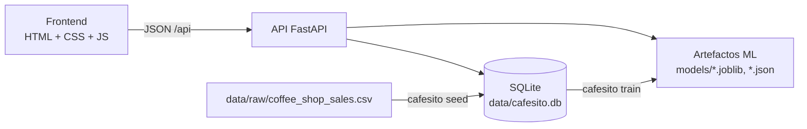

# Cafesito Feli

Panel de ventas y servicios de minería de datos para una cadena de tres cafeterías en Nueva York. Proyecto de **Minería de Datos (IEI-067)**, Santo Tomás, construido sobre el proceso CRISP-DM.

La aplicación entrega, en una sola interfaz y sin conocimientos técnicos:

- **Panel**: ingresos, transacciones, unidades y ticket promedio, con variación real frente al trimestre anterior, filtrable por sede y período.
- **Predictor de demanda** (Árbol de Decisión): dada una sede, día, mes y hora, indica si se espera demanda alta o baja para planificar turnos.
- **Segmentos de productos** (K-Means): agrupa el menú en Estrella, Complemento y Premium de nicho, y clasifica productos nuevos.
- **Combos** (Apriori): reglas de venta cruzada con soporte, confianza y lift.

## Arquitectura



- La base SQLite es un artefacto derivado del CSV: `seed` la reconstruye en segundos, por lo que el despliegue no depende de un disco persistente.
- Los modelos se entrenan desde la base (`train`) y se guardan con `joblib`/JSON. La API los carga al iniciar y responde `503` con un mensaje amable si aún no existen.
- El frontend lo sirve la misma API: un solo despliegue, sin CORS.

## Estructura

```
src/cafesito/
  api/        app, routers, esquemas y manejo de errores
  db/         modelos SQLAlchemy, sesión, consultas analíticas y seed
  ml/         dataset, demanda (árbol), segmentación (K-Means), asociación (Apriori), artefactos
  web/        frontend estático (index.html, css/, js/)
  cli.py      comandos seed, train, bootstrap y serve
tests/        unit/ e integration/
data/raw/     dataset original
models/       artefactos entrenados (ignorados por git)
```

## Puesta en marcha

Requiere Python 3.11 o superior.

```bash
python -m venv .venv
source .venv/bin/activate
pip install -e ".[dev]"
```

En Windows, activa el entorno con `.venv\Scripts\activate`.

```bash
python -m cafesito bootstrap
python -m cafesito serve
```

`bootstrap` carga el CSV en SQLite y entrena los modelos solo si faltan. Luego abre <http://127.0.0.1:8000>. La documentación interactiva de la API está en <http://127.0.0.1:8000/api/docs>.

| Comando | Qué hace |
|---|---|
| `python -m cafesito seed` | Reconstruye la base desde el CSV |
| `python -m cafesito train` | Entrena y guarda los tres modelos |
| `python -m cafesito bootstrap` | `seed` y `train` solo si faltan |
| `python -m cafesito serve` | Levanta la API y el frontend |

La configuración se toma de variables de entorno con prefijo `CAFESITO_` (ver `.env.example`).

## API

| Método | Ruta | Descripción |
|---|---|---|
| GET | `/api/health` | Estado de la base y los modelos |
| GET | `/api/stores` | Sedes |
| GET | `/api/kpis` | Indicadores y variación (`store_id`, `quarter`) |
| GET | `/api/sales/by-category` · `/monthly` · `/hourly` | Series para los gráficos |
| GET | `/api/products/top` | Productos más vendidos (`limit`) |
| GET | `/api/predictions/demand/options` | Opciones válidas del predictor |
| POST | `/api/predictions/demand` | Predicción de demanda alta o baja |
| GET | `/api/segments` | Segmentos y productos asignados |
| POST | `/api/segments/classify` | Segmento de un producto nuevo |
| GET | `/api/product-types` | Tipos de producto |
| GET | `/api/recommendations` | Reglas de asociación (`product_type`) |

Los errores siguen el formato `{"error": {"code": "...", "message": "..."}}` con mensajes en español y nunca exponen trazas de Python.

## Resultados de los modelos

Se reproducen con `python -m cafesito train` y quedan en `models/metrics.json`.

| Modelo | Métrica | Resultado |
|---|---|---|
| Árbol de Decisión (`max_depth=5`) | Accuracy en prueba | ≈ 77 %, frente a 51,5 % del baseline |
| K-Means (K=3) | Coeficiente de silueta | 0,579 |
| Apriori | Reglas encontradas | 8, de las cuales 6 con lift > 1,2 |

## Calidad

```bash
ruff check .
ruff format --check .
mypy
pytest
```

- `pytest` exige al menos 85 % de cobertura (actualmente ≈ 98 %).
- El código no contiene comentarios; `tests/test_no_comments.py` lo hace cumplir.
- El CI (`.github/workflows/ci.yml`) ejecuta lint, formato, tipos, pruebas y una construcción de la imagen Docker con prueba de humo.
- `pre-commit install` activa los mismos chequeos en cada commit.

## Despliegue

Se incluye un `Dockerfile` que prepara base y modelos durante la construcción, y un `render.yaml` para Render.

```bash
docker build -t cafesito-feli .
docker run -p 8000:8000 cafesito-feli
```

Luego abre <http://127.0.0.1:8000>.

## Datos

Dataset *Coffee Shop Sales* de Maven Analytics (Kaggle): 149.116 líneas de venta entre el 1 de enero y el 30 de junio de 2023, en 3 sedes y 80 productos.
